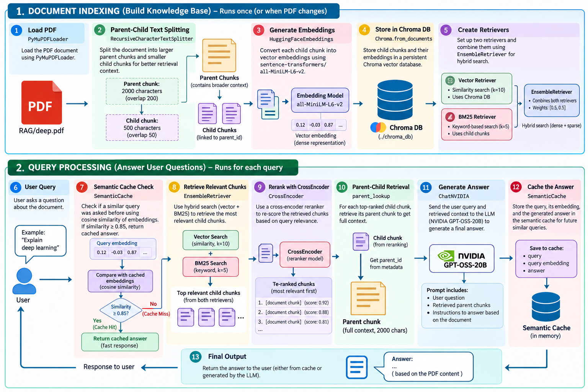

# Generative AI Experiments

This folder contains a small collection of Python experiments and prototypes focused on generative AI, LangChain, retrieval-augmented generation (RAG), document loading, and tool-calling workflows.



## Overview

- `chatModels/` – Streamlit-based chat apps and model experiments
- `RAG/` – Retrieval and production-style RAG examples
- `doc_loader/` – PDF and document ingestion experiments
- `tools/` – tool-calling and simple agent utility scripts
- `requirements.txt` – Python dependencies for the project

## Prerequisites

- Python 3.10+
- `pip`
- A working virtual environment
- API keys in a `.env` file for any model provider you use (for example `OPENAI_API_KEY` or `NVIDIA_API_KEY`)

## Quick start

Copy and paste this into your terminal:

```bash
cd /Users/gunjeshnayak/Desktop/generativeAI
python3 -m venv .venv
source .venv/bin/activate
python -m pip install --upgrade pip
pip install -r requirements.txt
```

Then create a `.env` file in the project root if needed:

```bash
cat > .env <<'EOF'
OPENAI_API_KEY=your_openai_key_here
NVIDIA_API_KEY=your_nvidia_key_here
EOF
```

## Run the examples

### Streamlit chat app

```bash
cd /Users/gunjeshnayak/Desktop/generativeAI
source .venv/bin/activate
streamlit run chatModels/app.py
```

### Local RAG example

```bash
cd /Users/gunjeshnayak/Desktop/generativeAI
source .venv/bin/activate
python RAG/production_RAG.py
```

### Document loader test

```bash
cd /Users/gunjeshnayak/Desktop/generativeAI
source .venv/bin/activate
python doc_loader/main.py
```

### Tool calling example

```bash
cd /Users/gunjeshnayak/Desktop/generativeAI
source .venv/bin/activate
python tools/toolCalling.py
```

## Notes

- The project is experimental and may mix prototype scripts, local document indexes, and model integrations.
- Some examples rely on external model APIs and may require internet access.
- `chroma_db/` is used as a local vector database for embedding-based retrieval.

## Common troubleshooting

- If a module is missing, run `pip install -r requirements.txt` again inside the active virtual environment.
- If a model call fails, verify your API keys in `.env`.
- If a script cannot find files, run it from the project root instead of a subfolder.
